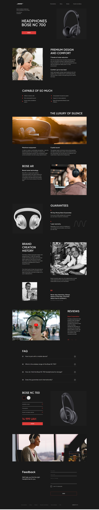

# Bose Product Page

Welcome to the Bose Product Page! This project is a web application that
showcases various Bose products. Users can explore different product categories,
view detailed information about each product, and enjoy a visually appealing,
responsive design.



## Features

- **Product Listings**: Browse through a variety of Bose products.
- **Product Details**: View detailed information about each product, including
  specifications and pricing.
- **Responsive Design**: The site is fully responsive and works well on all
  devices.
- **Interactive UI**: Smooth and interactive user interface for a great user
  experience.

## Technologies Used

- **HTML5**: For the structure of the web pages.
- **CSS3**: For styling the web pages, including flexbox and grid for layout.
- **JavaScript**: For adding interactivity to the site.
- **jQuery**: For simplified DOM manipulation.
- **Bootstrap**: For responsive design and components.
- **SASS**: For more efficient and organized CSS.

## Project Setup

1. Clone the repository:

```
git clone https://github.com/pohorielova/Bose.git
cd Bose
```

2. Open the project in your preferred code editor.

3. Open `index.html` in your browser to view the application locally.

## Contributions

Contributions are welcome! If you would like to contribute to this project,
please follow these steps:

1. Fork the repository.
2. Create a new branch: `git checkout -b my-feature-branch`.
3. Make your changes and commit them: `git commit -m 'Add some feature'`.
4. Push to the branch: `git push origin my-feature-branch`.
5. Create a pull request.

## Acknowledgements

- Thanks to the creators of the APIs used in this project.
- Special thanks to the team members who contributed to the development of this
  site.
